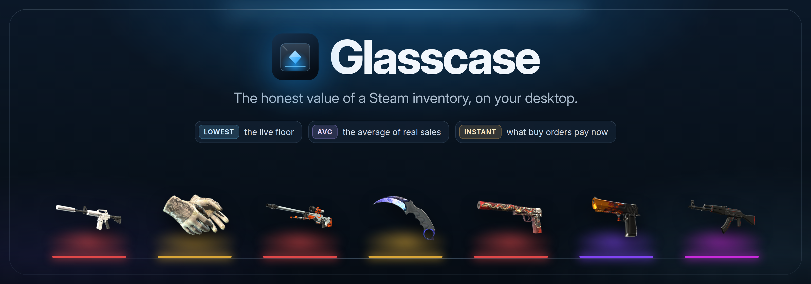
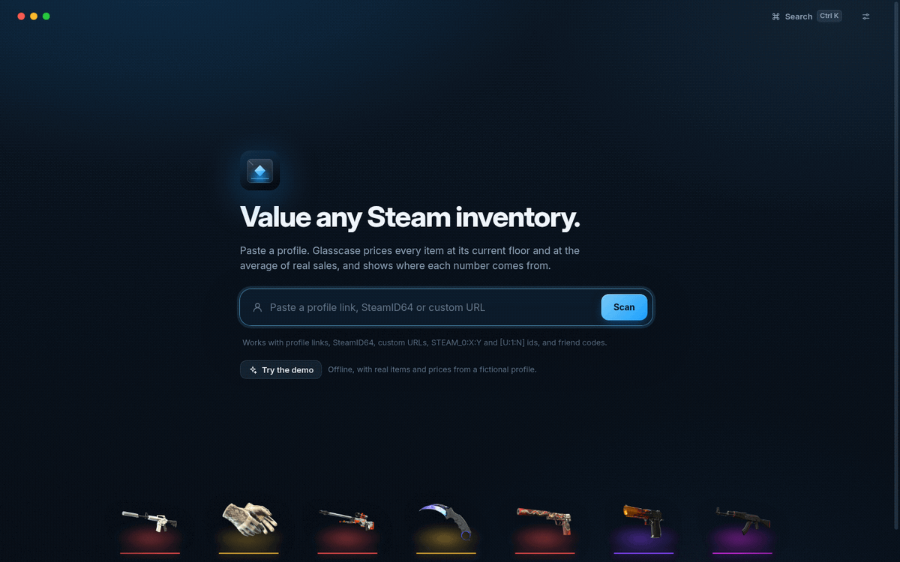
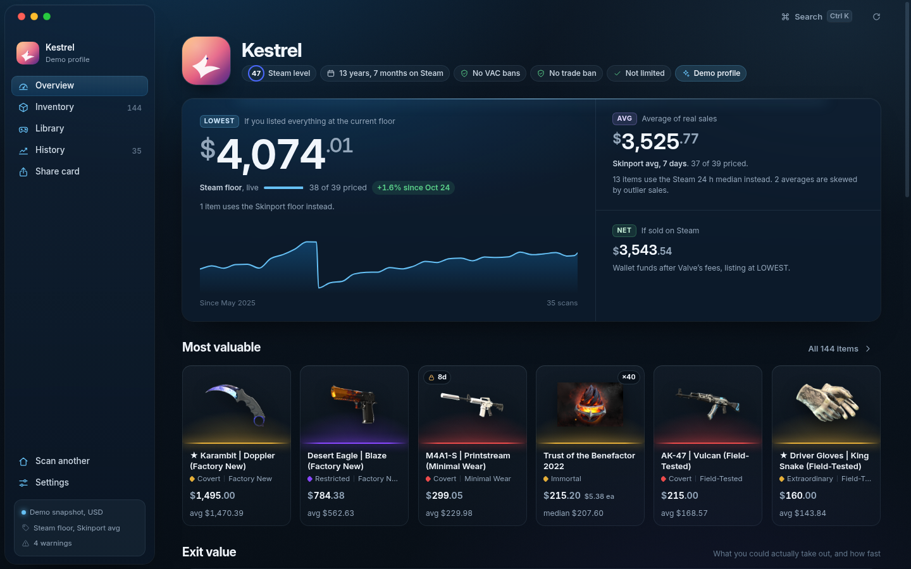
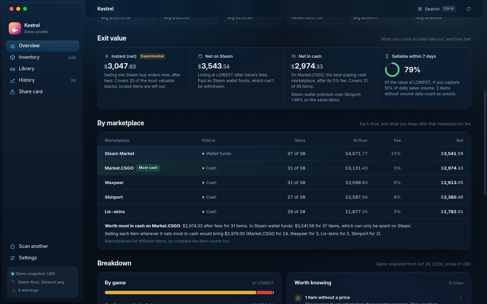
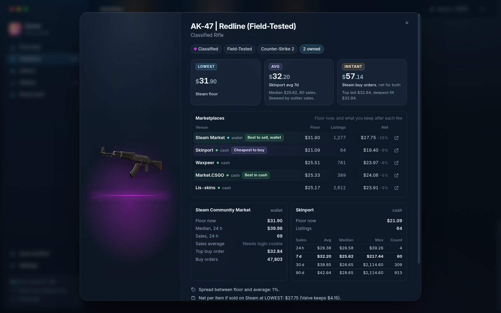
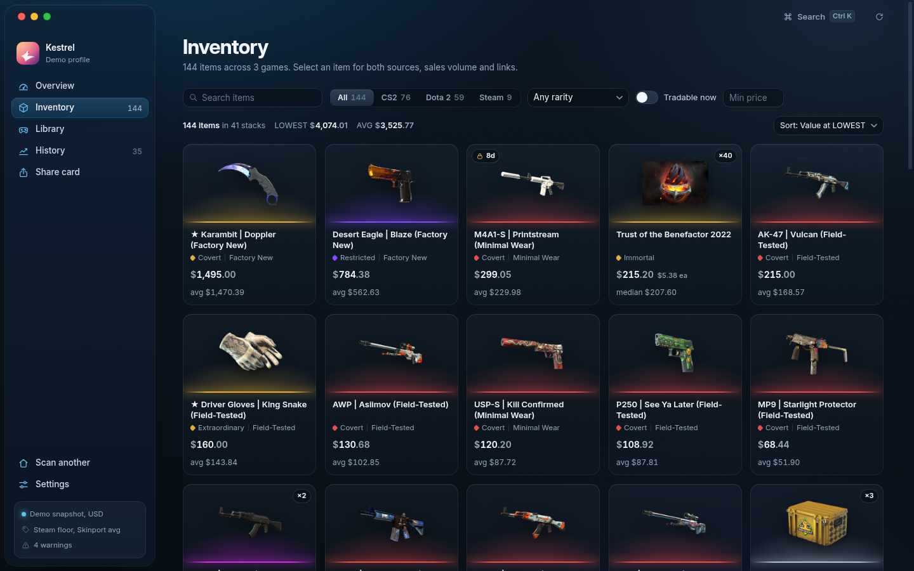
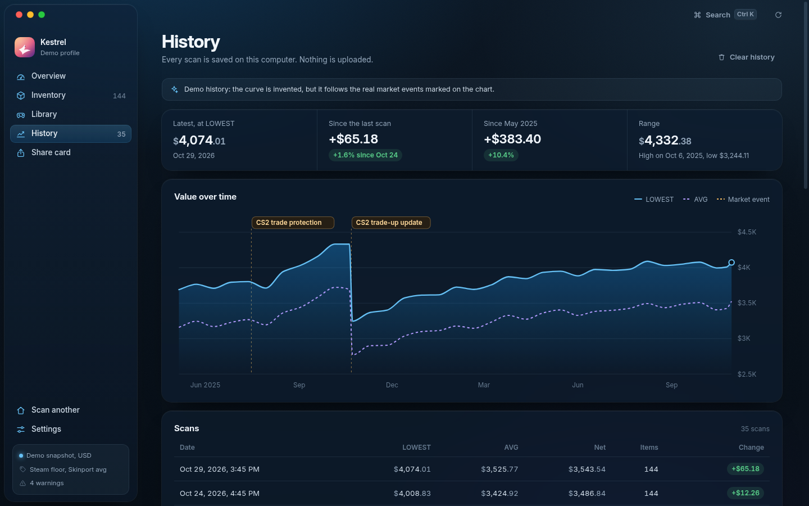
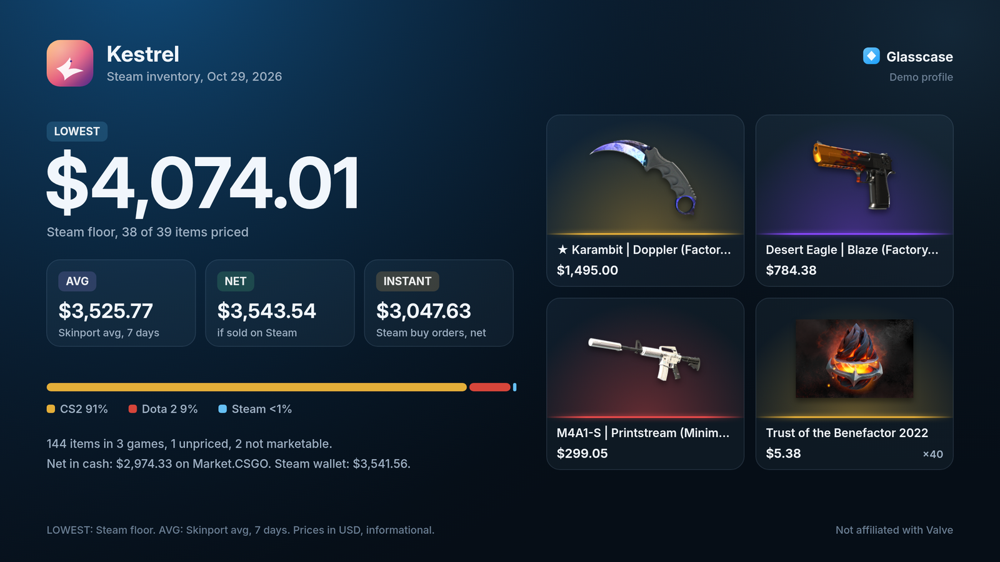
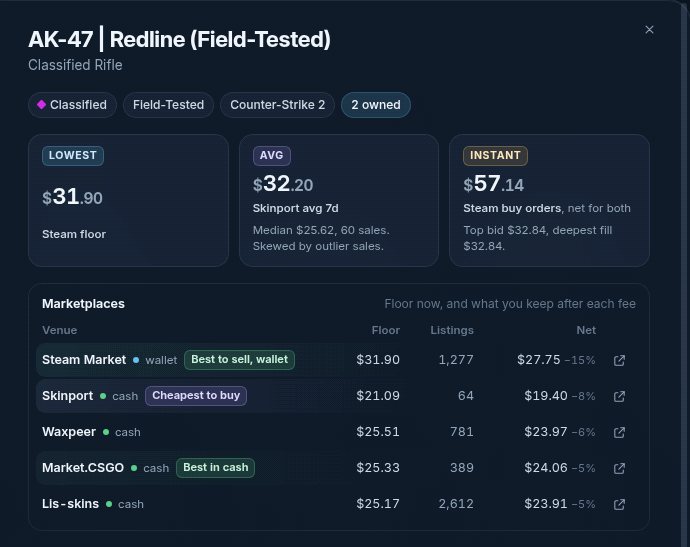

<p align="center">
  
</p>

<p align="center">
  
</p>

<h3 align="center">See what a Steam inventory is worth: the live floor, the average of real sales, what every marketplace pays, and what you could actually take out.</h3>

<p align="center">
  
  
  
  
  
  
  <a href="https://github.com/FollowerDemolish/steam-inventory-tracker-valuator/actions/workflows/ci.yml"></a>
</p>

<p align="center">
  
</p>

<table>
  <tr>
    <td width="50%"></td>
    <td width="50%"></td>
  </tr>
  <tr>
    <td></td>
    <td></td>
  </tr>
</table>

<p align="center">
  
</p>

<br />

## Everything in one case

<table>
  <tr>
    <td width="33%" valign="top">
      <b>Paste anything</b><br />
      Profile links, SteamID64, custom URLs, <code>STEAM_0:X:Y</code>, <code>[U:1:N]</code>, friend codes and <code>s.team</code> invites. Recent profiles and a <kbd>Ctrl</kbd>/<kbd>Cmd</kbd>+<kbd>K</kbd> palette.
    </td>
    <td width="33%" valign="top">
      <b>Two honest totals</b><br />
      LOWEST is the live floor. AVG is the average of real sales over 24 h, 7, 30 or 90 days. Every number names its source and window.
    </td>
    <td width="33%" valign="top">
      <b>Every marketplace, side by side</b><br />
      Steam, Skinport, Waxpeer, Market.CSGO and Lis-skins floors per item, net after each fee, the cheapest place to buy and the best place to sell. Wallet funds and cash are never mixed.
    </td>
  </tr>
  <tr>
    <td valign="top">
      <b>Outlier guard</b><br />
      The median and the biggest sale sit beside every average. Skewed averages are flagged, and an optional trimmed mean is always labelled.
    </td>
    <td valign="top">
      <b>Exit value</b><br />
      Instant (net) from Steam buy orders walked for the quantity you hold, net in Steam wallet funds, net in cash on the best-paying marketplace, and how much sells within a week.
    </td>
    <td valign="top">
      <b>Warnings that matter</b><br />
      Unpriced items are counted, never zeroed. Non-marketable items stay out of totals. Thin trading, wide spreads and trade holds are called out.
    </td>
  </tr>
  <tr>
    <td valign="top">
      <b>A real inventory view</b><br />
      Item art on a lit shelf, rarity shown by colour, shape and name, wear, quantity and locks. Filter, sort and search in an instant.
    </td>
    <td valign="top">
      <b>History, kept locally</b><br />
      Every scan is saved on your computer and charted over time, with the 2025 CS2 market events marked on the timeline.
    </td>
    <td valign="top">
      <b>Library, kept apart</b><br />
      With a free Steam Web API key, see what your games would cost to buy again. It is never added to the inventory as an "account worth".
    </td>
  </tr>
  <tr>
    <td valign="top">
      <b>Share cards</b><br />
      Export a PNG summary or picture grid in four themes, with an optional net-by-marketplace line. One switch hides your name, avatar and SteamID.
    </td>
    <td valign="top">
      <b>Honest currency</b><br />
      USD-only marketplaces are converted with free daily exchange rates, and the rate and its date are shown wherever a converted number appears.
    </td>
    <td valign="top">
      <b>Portable and private</b><br />
      One portable .exe or AppImage, data kept next to it, no accounts and no telemetry. Optional keys stay on your computer.
    </td>
  </tr>
</table>

<p align="center">
  
</p>

<br />

## How prices work

Glasscase answers two different questions and never mixes them up.

| Metric | Question it answers | Default source | Window |
| --- | --- | --- | --- |
| **LOWEST** | What is the cheapest live listing right now? | Steam Community Market floor (`priceoverview`); or the best floor across marketplaces, or one marketplace you pick | now |
| **AVG** | What have people actually paid? | Skinport sales history, mean of sales | 7 days (24 h, 30 d and 90 d selectable) |
| **NET** | What lands in your Steam wallet if you list at LOWEST? | LOWEST minus Valve's fees | now |
| **Instant** | What would buy orders pay this minute? | Steam order book, walked for your quantity (opt-in, experimental) | now |

**Sources.** LOWEST comes from the Steam floor by default, falling back to Skinport. In Settings you can switch it to the best floor across every enabled marketplace, or to one marketplace. AVG comes from Skinport sales by default, or from Steam sales. Where the chosen source has nothing, another is used and the number is marked as a fallback with the reason (for example "Steam median 24h, because Skinport does not list this item"). Steam Community items such as cards, gems and backgrounds only exist on Steam, so their AVG is Steam's 24 h median, labelled as such. If you add your own `steamLoginSecure` cookie, AVG can come from Steam's full sales history instead.

**Wallet versus cash.** Steam pays sellers in Steam wallet funds, which can only be spent on Steam. Every other marketplace pays cash. Glasscase keeps the venue on every number, shows net in wallet funds and net in cash separately, and tells you where the inventory is worth most in each.

### Price sources

All sources are free and need no account. Each one is fetched by the main process, cached, and throttled; a marketplace that fails is skipped with a note instead of stopping the scan.

| Venue | Access | Games | What Glasscase uses | Caveats |
| --- | --- | --- | --- | --- |
| Steam Community Market | `priceoverview`, no key | Every marketable item | Floor (LOWEST), 24 h median and volume | About 20 requests a minute per IP; paid out as wallet funds |
| Steam order book | Undocumented, no key | Every marketable item | Buy-order ladder for Instant (opt-in, experimental) | Currency follows your IP region; cached 1 h |
| Steam sales history | Your own `steamLoginSecure` cookie (optional) | Every marketable item | AVG over 24 h to 90 d | The cookie is a full session credential |
| Skinport | Public API, no key | CS2, Dota 2, TF2, Rust | Floor, and the mean, median and max of sales for AVG | 8 requests per 5 minutes; whole-game catalogs |
| Waxpeer | Public price list, no key | CS2, Dota 2, Rust, TF2 | Floor and listing count | USD only, converted; cached 1 h |
| Market.CSGO | Public price list, no key (and its sister sites market.dota2.net, tf2.tm, rust.tm) | CS2, Dota 2, TF2, Rust | Floor (lowest offer) and offer count | USD only, converted; cached 1 h |
| Lis-skins | Public price export, no key | CS2, Dota 2, Rust | Floor, listing count and item link | USD only, converted; no TF2 export; cached 1 h |
| CSFloat | Undocumented website endpoint, no key (opt-in, experimental) | CS2 | Daily sales averages as a second AVG source for your top items | Includes float and sticker premiums, so it runs high; the outlier guard applies |
| open.er-api.com | Free exchange rates, no key | | USD to your currency | Daily rates, cached 12 h; the rate and date are shown with every converted number |

Seller fees are settings with these defaults: Skinport 8%, Waxpeer 6%, Market.CSGO 5%, Lis-skins 5%. They are assumptions; check each marketplace's own fee page and adjust them. Steam's fee is Valve's exact 5% + 10% algorithm.

**Outliers.** One $2,114 sale can drag a $26 skin's 30-day mean to $39.85. Glasscase shows the median and the maximum next to every mean, flags an average as skewed when mean and median differ by more than 25% or the biggest sale is above 5x the median, and offers a trimmed mean (dropping the single highest and lowest sale) that is always labelled "trimmed".

**Fees.** Net on Steam uses Valve's own fee algorithm: a 5% Steam fee and a 10% publisher fee, each at least one cent, rounded exactly as the Steam client does. A buyer paying $31.90 leaves you $27.75. Net on every other marketplace is its floor minus that marketplace's seller fee.

**Liquidity.** Days to sell assume you capture 10% of an item's daily volume (adjustable). "Sellable within 7 days" is the share of value you could move in a week at that pace. Locked items count toward LOWEST and AVG but never toward Instant.

**Rate limits.** Steam allows only a few inventory requests and about 20 price requests a minute per IP. Glasscase caches inventories for 10 minutes and prices for hours, throttles each service, backs off with jitter, honours `Retry-After`, and checks the most valuable items first. When Steam refuses, you get a plain message, the cached data, and the demo.

## Where to run it

Run Glasscase on your **home PC. Windows is recommended**, using the portable `.exe`.

Steam rate-limits datacenter, VPS and cloud IP addresses heavily. In our own tests a Linux server in a datacenter got HTTP 429 on its very first inventory request, so live scans from servers are unreliable. Home Linux and macOS desktops work fine: use the AppImage, or build from source.

On a server, only the offline demo and data you already have in the cache work reliably. Glasscase does not bundle proxies or any other way around Steam's limits.

## Download & run

> [!TIP]
> Run it on your home computer, ideally Windows with the portable `.exe`. Steam blocks datacenter and cloud IPs quickly, so on a server only the demo and cached data work reliably.

**Download the release — no build, no clone.** Open **[Releases](https://github.com/FollowerDemolish/steam-inventory-tracker-valuator/releases/latest)** and take the Windows build:

| Build | File |
| --- | --- |
| Windows 10/11 (x64) | [`Glasscase-2.3.41-portable-x64.exe`](https://github.com/FollowerDemolish/steam-inventory-tracker-valuator/releases/download/v2.3.41/Glasscase-2.3.41-portable-x64.exe) |

Double-click the `.exe` and Glasscase opens — nothing is installed, no Node.js, no npm, no Git needed. The build keeps its data in a `Glasscase Data` folder next to itself, so you can carry it on a USB stick.

If Windows shows a blue warning on first run, click **More info** &rarr; **Run anyway**. The app is not code-signed yet; the warning appears once.

<details>
<summary><b>Building from source (optional)</b></summary>

You need Node 22 and npm. Linux gets an AppImage this way; Windows gets the same portable `.exe` as the release.

```bash
git clone https://github.com/FollowerDemolish/steam-inventory-tracker-valuator.git
cd steam-inventory-tracker-valuator
npm ci
npm run build:win     # dist/Glasscase-2.3.41-portable-x64.exe
npm run build:linux   # dist/Glasscase-2.3.41-x86_64.AppImage
```

On Linux, make the AppImage executable with `chmod +x`. If it fails with `error loading libfuse.so.2`, install FUSE 2 (`sudo apt install libfuse2t64` on Ubuntu 24.04+), or start it with `--appimage-extract-and-run`.

</details>

Want to look around without touching Steam? Open the app and choose **Try the demo**. It works offline with a fictional profile that holds real CS2, Dota 2 and Steam items, priced from public market data captured on October 29, 2026.

## Privacy

- No accounts, no telemetry, no analytics, no ads.
- Glasscase talks only to Steam, the Steam image CDN, the marketplaces you enable (Skinport, Waxpeer, Market.CSGO and its sister sites, Lis-skins, and CSFloat if you opt in) and open.er-api.com for exchange rates. Every request comes from the main process with an honest User-Agent; the window itself never touches the network. Marketplaces only see a request for a whole price list, never your SteamID.
- Your optional Steam Web API key and `steamLoginSecure` cookie are stored in the data folder on your computer, are sent only to Steam, and are never written to logs in full. The cookie is a full session credential: Glasscase explains this where you paste it, and you can remove it with one click.
- Scan history, recent profiles and caches stay in the data folder. Settings shows where it is and can clear the cache.
- The share card has a privacy switch that hides name, avatar and SteamID.

## Build from source

You need Node 22 and npm.

```bash
npm ci
npm start              # run the app
npm test               # unit tests (node:test)
npm run smoke          # launch, load the demo, render Overview and Inventory, save screenshots, exit 0
npm run shots          # full screenshot tour into assets/shots/
npm run assets         # re-render the app icon and the README hero
npm run gifs           # re-record assets/demo.gif and assets/marketplaces.gif from the real app
npm run build          # Windows portable .exe and Linux AppImage into dist/
```

On a Linux machine without a display, prefix the Electron commands with `xvfb-run -a` (for `npm run gifs`, use `xvfb-run -a -s "-screen 0 1920x1080x24"`). Windows builds from Linux work without Wine because executable editing and signing are turned off.

The renderer is plain HTML, CSS and ES modules with no framework and no bundler. Pricing, parsing, fees and aggregation live in `src/core/` and are covered by tests. The window runs with context isolation, a sandbox, no Node integration and a strict Content Security Policy, and reaches the main process through a narrow preload API.

## Roadmap

- Alerts: optional OS notifications when the total or a chosen item moves by more than a set amount.
- Trade checker: compare two sides of a trade at LOWEST, AVG and Instant, with overpay, liquidity and lock warnings.
- A consensus view per item that flags marketplaces more than 30% away from the others.
- Multi-profile roll-up with per-profile and per-game subtotals.
- Sell planner that compares Steam and Skinport proceeds and suggests staggering big stacks. Planning only: it never lists or sells anything.
- "Premium possible" flags for StatTrak, Souvenir, applied stickers, name tags and Doppler phases.
- System proxy support and a light theme.
- macOS build.

## Disclaimer

Glasscase is an independent open-source project. It is not affiliated with, endorsed by or sponsored by Valve Corporation, Steam, Skinport, Waxpeer, Market.CSGO, Lis-skins or CSFloat. Steam and the Steam logo are trademarks of Valve Corporation. Prices come from public marketplace data, are informational only and can be wrong or out of date. Nothing here is financial advice. Steam accounts cannot be sold under the Steam Subscriber Agreement, and Glasscase never presents a total as an account's sale value.

## License

[MIT](LICENSE), Copyright (c) 2026 FollowerDemolish. The bundled Inter typeface is licensed under the [SIL Open Font License 1.1](src/renderer/fonts/OFL.txt).
